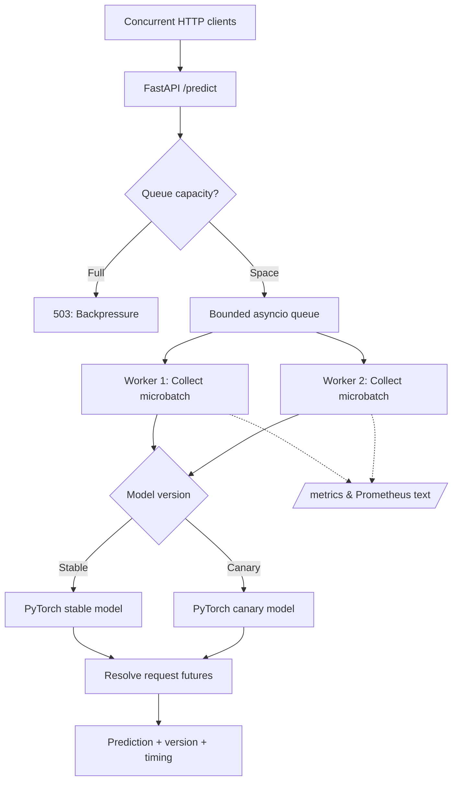

# ⚡ PyTorch Inference Serving Runtime

**A practical look inside ML model serving: batching, backpressure, worker scheduling, canary routing, and observable latency.**

[](https://www.python.org/)
[](https://pytorch.org/)
[](https://fastapi.tiangolo.com/)


> **The engineering question:** When concurrent requests arrive faster than a model can handle individually, how do we batch work without losing control of latency, overload behavior, and observability?

Rather than calling a model directly from every HTTP request, this project separates **request admission**, **queued scheduling**, **batched model execution**, and **response delivery**. It uses a trained PyTorch classifier and a configurable FastAPI inference engine.

## 📊 Benchmark snapshot

These figures come from the recorded run in [`results/load.json`](results/load.json). The workload uses **600 requests**, **32 concurrent clients**, and an **in-process ASGI transport** (no network round trip).

| Measurement | Recorded result |
| --- | ---: |
| Successful HTTP responses | **600 / 600** |
| Throughput | **1,767.31 requests/s** |
| p50 response latency | **5.564 ms** |
| p95 response latency | **14.275 ms** |
| p99 response latency | **147.819 ms** |
| Rejected / failed requests | **0 / 0** |
| Worker tasks | **2** |
| Batches executed | **19** |

**Interpretation:** This benchmark checks the local request-handling path; it does **not** measure network serving capacity, multi-host scaling, GPU utilization, or production SLOs. The relatively high p99 is worth investigating rather than hiding.

## 🧠 How it works



Each request carries a feature vector and a future. A worker collects up to `MAX_BATCH` requests within `BATCH_WAIT_MS`, groups them by model version, executes tensor inference, then resolves each response. Queue saturation returns **HTTP 503**; requests that time out return **HTTP 504**.

### Engineering choices

| Design choice | Why it matters | Trade-off |
| --- | --- | --- |
| Dynamic microbatching | Amortizes model invocation overhead | Waiting for a batch can increase individual latency |
| Bounded queue | Prevents unlimited request buildup | Rejects traffic under overload |
| Multiple asyncio workers | Allows concurrent request scheduling | Still one Python process, not distributed execution |
| Stable/canary routing | Exposes an experimentation path | Both variants currently have identical weights |
| p50/p95/p99 and counters | Makes bottlenecks and failures visible | In-memory metrics reset when the process restarts |

## 🚀 Run locally

**Requirements:** Python 3.10+ and a CPU-supported PyTorch installation.

```bash
git clone https://github.com/MSrikar7/pytorch-inference-serving-runtime.git
cd pytorch-inference-serving-runtime

python -m venv .venv
source .venv/bin/activate   # Windows PowerShell: .venv\Scripts\Activate.ps1
python -m pip install -r requirements.txt

# Train the reproducible synthetic classification model
python training/train.py

# Run the API from the repository root
uvicorn app.server:app --host 127.0.0.1 --port 8000
```

Open **http://127.0.0.1:8000/docs** to try the interactive API.

For a quick prediction (32 numeric features):

```bash
python -c "import json,urllib.request; payload=json.dumps({'features':[0.2]*32}).encode(); req=urllib.request.Request('http://127.0.0.1:8000/predict',data=payload,headers={'Content-Type':'application/json'}); print(urllib.request.urlopen(req).read().decode())"
```

Expected **response shape** (class and timing depend on the trained model and the run):

```json
{
  "class_id": 2,
  "version": "stable",
  "batch_size": 8,
  "latency_ms": 4.2
}
```

### Tests and load testing

Run these from the repository root **after training**:

```bash
python -m pytest -q tests
python -m benchmarks.load --requests 600 --concurrency 32
```

The benchmark uses HTTPX's ASGI transport directly against the FastAPI app. Results vary by CPU, scheduling, installed PyTorch version, and load.

## 🛠 Configuration

| Environment variable | Default | Purpose |
| --- | --- | --- |
| `MODEL_PATH` | `artifacts/model.pt` | Saved model checkpoint |
| `WORKERS` | `2` | Async worker tasks |
| `MAX_BATCH` | `32` | Batch size ceiling |
| `BATCH_WAIT_MS` | `5` | Maximum microbatch collection window |
| `QUEUE_LIMIT` | `512` | Maximum outstanding queued requests |
| `CANARY_FRACTION` | `0.1` | Probability of routing to the canary model |

## 🔍 API and observability

| Endpoint | Description |
| --- | --- |
| `POST /predict` | Classify a JSON object with 32 numeric `features` |
| `GET /health` | Report service readiness |
| `GET /metrics` | Return counters, queue depth, version split, and latency percentiles |
| `GET /metrics/prometheus` | Export numeric counters in Prometheus text format |

Try `/metrics` after a load test to inspect accepted, completed, rejected, and failed requests alongside stable/canary traffic counts.

## 📂 Repository map

```text
app/server.py          Inference engine, HTTP API, queue, workers and metrics
training/train.py      Reproducible PyTorch training on synthetic data
benchmarks/load.py     Concurrent in-process request generator
tests/test_serving.py  Validation, canary routing and overload checks
results/load.json      Recorded local benchmark snapshot
artifacts/model.json   Recorded training metadata
requirements.txt       Python dependencies
```

The model weights (`artifacts/model.pt`) are intentionally generated locally rather than committed.

## 🧪 Model and validation

The training script creates **10,000 synthetic training examples** and **2,000 synthetic test examples** using a generated classification target. The recorded test accuracy is **91.65%**. This is a controlled systems workload, **not** a real-world dataset or evidence of generalization to production data.

## 🧭 What I would build next

1. **True multi-process and multi-node serving** with network load balancing and independent worker lifecycle management.
2. **Model-aware admission control** and SLO-driven batching, backed by saturation and failure-injection experiments.
3. **Meaningful canary evaluation** with distinct model versions, shadow requests and automatic rollback criteria.
4. **Hardware-aware inference** with ONNX Runtime/C++ operator integration, profiling, and GPU benchmarks where suitable hardware is available.

---

**Project focus:** ML systems engineering · inference serving · asynchronous scheduling · performance measurement · resilient API design

*This is a production-inspired systems prototype. It does not claim production deployment, distributed multi-node operation, or validated GPU performance.*
